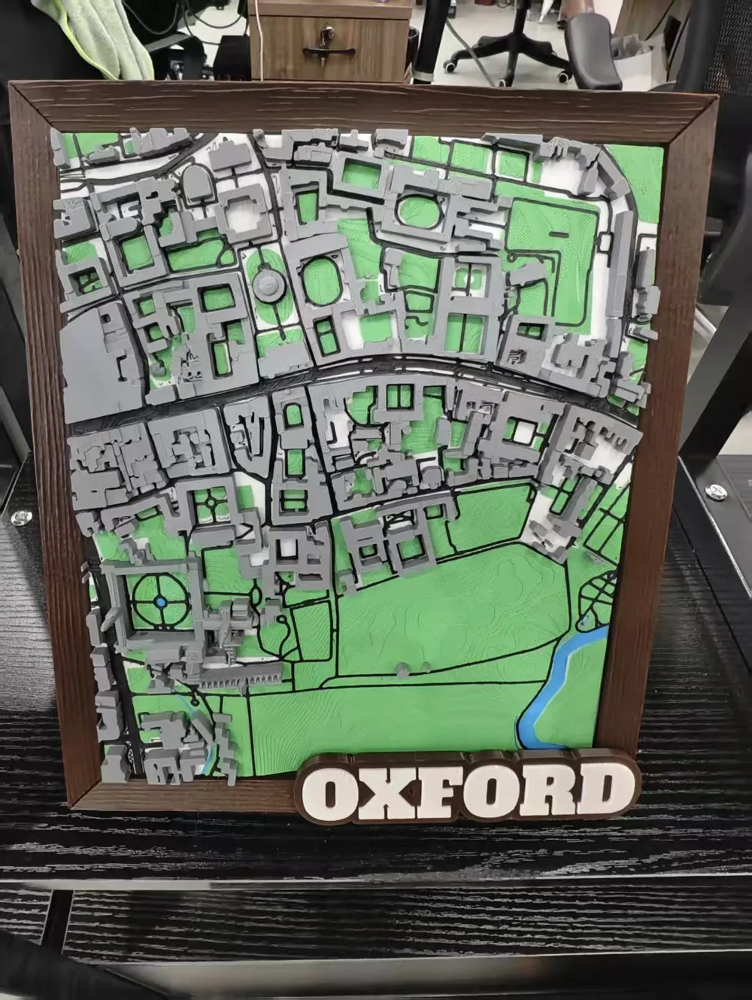

# Existing-model and Google Tiles checks

Checked 17 October 2026. No third-party mesh was downloaded: the useful candidates require the user's account. Public listing evidence and preview images are saved alongside this report.

## Best next unlock: free MakerWorld 3MF

[Oxford University map, model 2574076 / profile 2838133](https://makerworld.com/en/models/2574076-dream-university-prestigious-university-map-oxford#profileId-2838133).

- The listing is accessible in the ordinary browser, although automated HTTP fetches return 403. The download button explicitly reports **“Please log in to download models.”** See `makerworld-download-gate.png`.
- The public photograph shows the area from Radcliffe Camera to Christ Church Meadow. Merton appears in the block immediately above the meadow, east of Christ Church. This is a geographic inference from visible landmarks; the actual mesh and Merton detail cannot be validated until downloaded.
- It is a simplified architectural city map, with clear quads and largely flat or simple roofs. It could be a useful third benchmark beside our LiDAR and custom architectural models. Enlarging a crop will not create missing detail.
- **User action:** sign in to MakerWorld with your Bambu account; open the green button's dropdown; select **Download 3MF**; place the downloaded file in this local workspace. No API key or paid app is needed. An authorized local file can then be cropped to Merton and sliced with an A1 profile.
- Listing settings: 0.4 mm nozzle; 0.2 mm layers; 2 walls; 15% infill; 3 plates; advertised 15.7 hours. The visible printer profiles are H2/A2L, so this is not a verified A1 time or ready-to-run A1 project.
- License displayed: Standard Digital File License. Its expanded text prohibits redistribution of the digital/printed object and derivatives, and commercial use without permission. Keep the downloaded model and any personal crop local; do not publish it with our open-data outputs.

## Paid alternative: Micropolitan Oxford

[Oxford, UK — S, M, L, & XL, model 1254135](https://thangs.com/m/1254135).

- The official listing explicitly requires membership. `thangs-membership-gate.png` records this. No account or purchase was made.
- The larger public preview covers central Oxford, Christ Church and the adjacent meadow; Merton's area is therefore included geographically. Individual Merton features and file quality are not confirmed without the mesh.
- The creator describes LiDAR-based modeling with architectural refinements. The preview still shows faceted surface detail; the README's claim that it is definitely the best-quality choice is unverified.
- **User action:** if wanted, obtain an appropriate Micropolitan Thangs membership, download the Oxford STL set and included sizing PDF, and place the original files locally. Review the membership's personal-use/cropping terms before processing. Current price and exact per-file extents were not confirmed.
- The creator recommends at least 150 × 150 mm, a 0.4–0.6 mm nozzle, 0.18–0.25 mm layers and 15% gyroid for city-map prints. These are not dimensions for a Merton-only crop.

## Google Photorealistic 3D Tiles / Blosm

**Not recommended as a printable-STL route under the standard terms.** An API key does not resolve the export restriction; the README's “gray area” characterization should not guide this choice.

[Google's Map Tiles API policies](https://developers.google.com/maps/documentation/tile/policies) restrict caching/storage and explicitly exclude geodata extraction and offline uses. [Google Maps Platform terms, §3.2.3(a)–(c)](https://cloud.google.com/maps-platform/terms) restrict exporting or extracting content for use outside the service and creating content based on it. A saved STL is an exported derivative, so do not request keys for this workflow without separate permission covering that use.

For authorized visualization, [Blosm's own setup documentation](https://github.com/vvoovv/blosm/wiki/Import-of-Google-3D-Cities) describes Blender plus the Blosm add-on, a Google Cloud project with billing, enabled Map Tiles API, and a Tiles API key entered in add-on preferences. That technical ability to import/export does not grant additional content rights. None of these apps, billing accounts or keys are required for the two open-data models being built here.

## Other Merton searches

- [Sketchfab's public API search for Merton](https://api.sketchfab.com/v3/search?type=models&q=Merton&count=100) was inspected and saved as `sketchfab-merton-search.json`. Results include Walter de Merton's tomb and unrelated Merton Street/Priory objects; no complete Oxford college model was found. The tomb is not downloadable.
- [Oxford VGG's multiview data](https://www.robots.ox.ac.uk/~vgg/data/mview/) actually contains Merton College I, II and III. These are three ground-level images per set, sparse reconstructed points/lines and camera matrices, not a complete textured building mesh or printable solid. They are unsuitable as the main full-college route. The source README is saved as `vgg-merton-i-description.txt`.
- This search does not prove that a private institutional scan does not exist. A college-commissioned scan or your own all-around photographs would be a separate acquisition route.

## Evidence files

`makerworld-download-gate.png`, `thangs-membership-gate.png`, `makerworld-oxford.jpg`, `makerworld-oxford-top.jpg`: public listing evidence, retained for private comparison with attribution to their respective creators. `makerworld-listing.txt`, `makerworld-license.txt`, `thangs-listing.txt`: observed public page text. `public-preview-sources.json`: original preview URLs. No listing assets are included as printable geometry.
